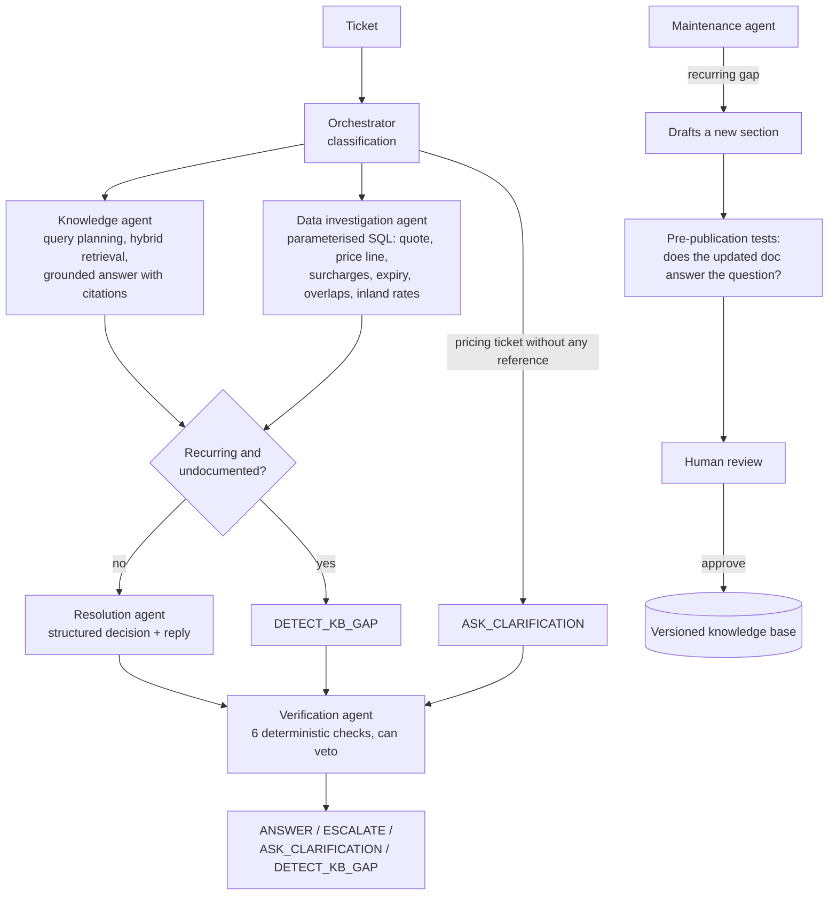

# Hypercare Agents

[](https://github.com/zeineeb33/hypercare-agents/actions/workflows/ci.yml)

A multi-agent system that handles support tickets during the **hypercare** phase of a software rollout: the weeks after go-live, when ticket volume spikes and the documentation is still catching up.

It answers from the documentation and the data, never invents a price, lets an independent verification agent veto unsafe answers, and detects recurring questions the documentation cannot answer, then drafts and tests a fix for a human to approve.

The domain is the pricing platform of a container shipping carrier. **The company (Northwind Shipping), its products (TideRate, QuotePort), the data and the documents are fictional.**

> Live demo: *coming soon* (Render, replay mode).

## Architecture



### The agents

| Agent | Type | Role |
|---|---|---|
| Orchestrator | Code | Routes the ticket, asks for clarification when a pricing ticket has nothing to investigate, traces every step |
| Knowledge agent | Claude (2 calls) | Writes search queries, retrieves sections (BM25, optionally fused with embeddings), answers **only** from them, cites them, flags insufficient evidence |
| Data investigation agent | SQL | Follows the references in the ticket (`QS-…`, `BK-…`, `PL-… line …`) and looks for the usual root causes |
| Pattern detection | Code | Many open tickets in a subcategory **and** a documentation that cannot answer them = knowledge gap |
| Resolution agent | Claude | Decides `ANSWER` / `ASK_CLARIFICATION` / `ESCALATE` and writes the reply, with the evidence used |
| Verification agent | Code | Six checks on the proposed reply; a blocking failure turns it into `ESCALATE`. **Fails closed**: if it cannot run, the ticket is escalated |
| Maintenance agent | Claude + code | Drafts a documentation update for each gap, tests it, stores it for review; approval versions and publishes the document |

### Verification checks

| Check | Blocks |
|---|---|
| Answered although the documentation is insufficient and no data supports the answer | yes |
| Answer given on a `DRAFT` (unpublished) price line | yes |
| Expired rate presented as current | yes |
| No source, or a cited document that was never retrieved | yes |
| Overlapping `ACTIVE` lines (hypercare must not choose) | yes |
| Pricing answer that states none of the actual amounts | warning |

## Engineering decisions

- **Structured outputs everywhere.** Every Claude call goes through `messages.parse` with a Pydantic schema, so agents exchange validated objects, not free text. Any API error, refusal, truncated or invalid output becomes an `LLMError`, and the pipeline escalates.
- **Deterministic where it matters.** SQL investigation, pattern detection and verification are plain code: they are testable, cheap and cannot hallucinate. The LLM writes; code decides whether the answer is safe to send.
- **Fail closed.** No path lets an unverified answer through: a crash in verification, a failed LLM call or a missing replay all end in an escalation.
- **Pre-publication tests that test something.** A documentation proposal is accepted only if the knowledge agent, re-run on the original question against the updated document, can now answer it.
- **Replay mode.** Only the LLM calls are recorded and replayed (keyed by a hash of the prompt). Retrieval, SQL and verification still run live in the public demo, at zero cost.
- **Small footprint.** BM25 is pure Python, the database is SQLite, so the demo fits Render's free tier. Dense embeddings (`fastembed`) are an optional extra.
- **Claude Opus 5.5** with adaptive thinking at `medium` effort, cacheable system prompts and server-side refusal fallbacks. The model is one setting (`HYPERCARE_MODEL`).

## Quickstart

```bash
uv sync                                   # Python 3.12
uv run hypercare seed                     # build the SQLite database
uv run hypercare serve                    # Streamlit app on http://localhost:8501 (replay mode)
uv run pytest --cov                       # tests: no network, no API key
```

Live mode (calls Claude):

```bash
cp .env.example .env                      # then put your ANTHROPIC_API_KEY in .env
uv run hypercare run 3                    # one ticket, with its trace and checks
uv run hypercare eval                     # the 27 evaluation cases
uv run hypercare maintain                 # detect gaps and draft documentation updates
uv run hypercare review 1 --reviewer you --approve
```

`--record` on `run`, `eval` and `maintain` saves the LLM answers for replay.

## Results

*Pending the first live evaluation run (27 cases).*

## Project structure

```
src/hypercare/
  agents/         orchestrator, knowledge, data investigation, resolution, verification, maintenance
  llm/            Anthropic client (structured outputs), replay/recording clients, fake for tests
  retrieval/      section chunking, BM25, optional embeddings, reciprocal rank fusion
  data/seed/      synthetic pricing data and 30 tickets
  data/kb/        fictional knowledge base (11 documents, including a video transcript)
  data/eval/      evaluation cases
  ui/             Streamlit app
  schema.sql      SQLite schema
tests/            pytest (fake LLM, local stub server for the SDK, Streamlit AppTest)
snowflake/        first prototype on Snowflake Cortex (see below)
```

## Background

The first prototype ran entirely inside Snowflake: Snowpark stored procedures, Cortex Search, Cortex `COMPLETE`, Streams and Tasks, and Streamlit in Snowflake. It is kept in [`snowflake/`](snowflake/). This version keeps its architecture and scenarios, and changes what a production version needs: portable Python, validated structured outputs, parameterised SQL, a verification step that fails closed, real pre-publication tests, an evaluation set and a test suite.

## License

MIT
