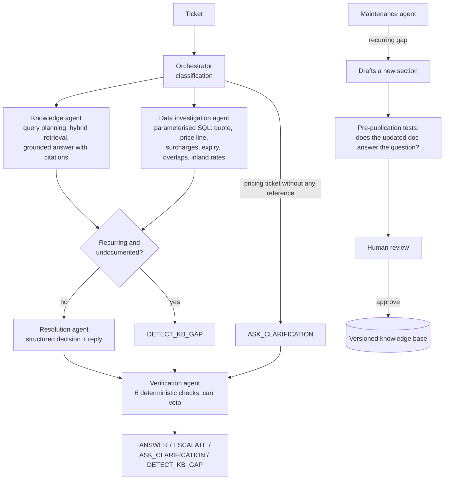

# Hypercare Agents

[](https://github.com/zeineeb33/hypercare-agents/actions/workflows/ci.yml)

An **agentic RAG** system for support tickets during the **hypercare** phase of a software rollout: the weeks after go-live, when ticket volume spikes and the documentation is still catching up.

Five agents answer each ticket from the documentation (retrieval-augmented generation with citations) and from the data (SQL), never invent a price, and let a deterministic **guardrail** agent veto unsafe answers. When the same question keeps coming back and the documentation cannot answer it, a maintenance agent drafts and **tests** a documentation fix for a **human** to approve: the knowledge base heals itself.

**Stack:** Claude (Anthropic SDK, structured outputs) · hybrid retrieval (BM25 + optional dense embeddings, RRF) · Python 3.12 · SQLite · Pydantic · Streamlit · pytest · Docker · GitHub Actions · Render

The domain is the pricing platform of a container shipping carrier. **The company (Northwind Shipping), its products (TideRate, QuotePort), the data and the documents are fictional.**

**Demo video:** https://youtu.be/st6TEws_vNs

[](https://youtu.be/st6TEws_vNs)

**Live demo:** https://hypercare-agents.onrender.com (free Render instance: the first visit after a period of inactivity can take up to a minute while it wakes up). The demo runs in replay mode: retrieval, SQL and verification run live, the LLM answers were recorded.

## What this project demonstrates

| Topic | How | Code |
|---|---|---|
| **Agentic RAG** | The LLM plans the search queries, hybrid retrieval returns document sections, the answer is grounded in them with citations, and the agent **abstains** (`insufficient_evidence`) instead of hallucinating | [`agents/knowledge.py`](src/hypercare/agents/knowledge.py), [`retrieval/`](src/hypercare/retrieval/) |
| **Hybrid search** | Section-level chunking, BM25, optional dense embeddings (`fastembed`), reciprocal rank fusion | [`retrieval/index.py`](src/hypercare/retrieval/index.py) |
| **Multi-agent orchestration** | Orchestrator routing five specialised agents, with clarification, escalation and knowledge-gap paths | [`agents/orchestrator.py`](src/hypercare/agents/orchestrator.py) |
| **Tool use on structured data** | A data agent that follows ticket references through parameterised SQL (quotes, price lines, surcharges, expiry, overlaps, inland rates) | [`agents/data_investigation.py`](src/hypercare/agents/data_investigation.py) |
| **Guardrails** | Six deterministic checks on every reply, veto power, **fail-closed** design, fault injection in the demo | [`agents/verification.py`](src/hypercare/agents/verification.py) |
| **Structured outputs** | Every LLM call is validated against a Pydantic schema (`messages.parse`) | [`llm/anthropic_client.py`](src/hypercare/llm/anthropic_client.py) |
| **LLM evaluation** | 27 scenario-based cases: decision accuracy, citation accuracy, fact accuracy, overrides, latency, cost per ticket | [`evaluation.py`](src/hypercare/evaluation.py) |
| **Observability** | Every agent step is traced with its inputs, outputs, sources, decision, latency, tokens and cost | [`tracing.py`](src/hypercare/tracing.py), *System* tab |
| **Human in the loop** | Documentation proposals are tested, reviewed, edited and versioned before publication | [`agents/maintenance.py`](src/hypercare/agents/maintenance.py) |
| **LLMOps** | Record/replay of LLM calls, prompt caching, server-side refusal fallbacks, cost tracking, model as a setting | [`llm/`](src/hypercare/llm/) |
| **Software engineering** | 79 tests without network or API key (fake LLM, stub server, Streamlit AppTest), strict mypy, ruff, CI, Docker | [`tests/`](tests/), [`.github/workflows/ci.yml`](.github/workflows/ci.yml) |

## Architecture



### The agents

| Agent | Type | Role |
|---|---|---|
| Orchestrator | Code | Routes the ticket, asks for clarification when a pricing ticket has nothing to investigate, traces every step |
| Knowledge agent | Claude (2 calls) | Writes search queries, retrieves sections (BM25, optionally fused with embeddings), answers **only** from them, cites them, flags insufficient evidence |
| Data investigation agent | SQL | Follows the references in the ticket (`QS-…`, `BK-…`, `PL-… line …`) and looks for the usual root causes |
| Pattern detection | Code | Many open tickets in a subcategory **and** a documentation that cannot answer them = knowledge gap |
| Resolution agent | Claude | Decides `ANSWER` / `ASK_CLARIFICATION` / `ESCALATE` and writes the reply, with the evidence used |
| Verification agent | Code | Six checks on the proposed reply; a blocking failure turns it into `ESCALATE`. **Fails closed**: if it cannot run, the ticket is escalated |
| Maintenance agent | Claude + code | Drafts a documentation update for each gap, tests it, stores it for review; approval versions and publishes the document |

### How the RAG works

1. **Chunking.** Each knowledge-base document (guides, business rules, release notes, FAQ, and the transcript of a video tutorial) is split on its `##` sections; every chunk keeps its file name, title, section and document version.
2. **Query planning.** Claude turns the ticket into one to three keyword queries, one per question in the ticket, in the domain's vocabulary rather than customer names or amounts.
3. **Hybrid retrieval.** The ticket and the planned queries are run through BM25 (and, with the `embeddings` extra, a dense model fused by reciprocal rank fusion). The best sections across queries are kept; the document linked to the ticket, if any, is always included.
4. **Grounded generation.** Claude answers from those sections only, cites the file names it used, mentions versions, and sets `insufficient_evidence` when the sections do not fully answer the question.
5. **Checked citations.** The verification agent blocks any reply that cites a document that was never retrieved, or that answers although the documentation was insufficient and no data supports it.
6. **Fresh index.** When a documentation proposal is approved, the document gets a new version and the index is rebuilt, so the next ticket retrieves the new section.

### Verification checks

| Check | Blocks |
|---|---|
| Answered although the documentation is insufficient and no data supports the answer | yes |
| Answer given on a `DRAFT` (unpublished) price line | yes |
| Expired rate presented as current | yes |
| No source, or a cited document that was never retrieved | yes |
| Overlapping `ACTIVE` lines (hypercare must not choose) | yes |
| Pricing answer that states none of the actual amounts | warning |

## Engineering decisions

- **Structured outputs everywhere.** Every Claude call goes through `messages.parse` with a Pydantic schema, so agents exchange validated objects, not free text. Any API error, refusal, truncated or invalid output becomes an `LLMError`, and the pipeline escalates.
- **Deterministic where it matters.** SQL investigation, pattern detection and verification are plain code: they are testable, cheap and cannot hallucinate. The LLM writes; code decides whether the answer is safe to send.
- **Fail closed.** No path lets an unverified answer through: a crash in verification, a failed LLM call or a missing replay all end in an escalation.
- **Pre-publication tests that test something.** A documentation proposal is accepted only if the knowledge agent, re-run on the original question against the updated document, can now answer it. The model is told to leave `[placeholders]` instead of inventing owners or delays; a proposal with placeholders cannot be approved until the reviewer fills them, and the tests run again on the edited text.
- **Replay mode.** Only the LLM calls are recorded and replayed (keyed by a hash of the prompt). Retrieval, SQL and verification still run live in the public demo, at zero cost.
- **Small footprint.** BM25 is pure Python, the database is SQLite, so the demo fits Render's free tier. Dense embeddings (`fastembed`) are an optional extra.
- **Claude Opus 5.5** with adaptive thinking at `medium` effort, cacheable system prompts and server-side refusal fallbacks. The model is one setting (`HYPERCARE_MODEL`).

## Quickstart

```bash
uv sync                                   # Python 3.12
uv run hypercare seed                     # build the SQLite database
uv run hypercare serve                    # Streamlit app on http://localhost:8501 (replay mode)
uv run pytest --cov                       # tests: no network, no API key
```

Live mode (calls Claude):

```bash
cp .env.example .env                      # then put your ANTHROPIC_API_KEY in .env
uv run hypercare run 3                    # one ticket, with its trace and checks
uv run hypercare eval                     # the 27 evaluation cases
uv run hypercare maintain                 # detect gaps and draft documentation updates
uv run hypercare review 1 --reviewer you --approve
```

`--record` on `run`, `eval` and `maintain` saves the LLM answers for replay.

## Results

27 evaluation cases covering the six scenarios plus documentation, booking, discount, incident and expiry questions ([`cases.json`](src/hypercare/data/eval/cases.json)):

| Metric | Result |
|---|---|
| Decision accuracy (`ANSWER` / `ESCALATE` / `ASK_CLARIFICATION` / `DETECT_KB_GAP`) | 27 / 27 |
| Answers citing the expected document | 100% |
| Answers stating the expected facts (amounts, contacts, delays) | 100% |
| Self-healing loop | gap detected on the inland-rate tickets only, proposal blocked until the reviewer fills its placeholders, approved, and the same five tickets then get an `ANSWER` |

**How to read this.** The LLM answers used here were produced by Claude Opus 5.5 through Claude Code (see [Recording without the API](#recording-without-the-api)), by the same session that wrote the cases, so these numbers show that the pipeline works end to end; they are not an independent benchmark. Latency and cost are not measured for replayed answers. `HYPERCARE_MODE=live uv run hypercare eval` runs the same cases against the API for an independent measurement.

The verification agent overrode nothing in this run because every proposed reply was safe. Its vetoes are covered by the tests, and the app has a **fault injection** switch that forces the resolution agent to answer so you can watch the checks block it (try ticket HC-2026-0006, a DRAFT line).

## Recording without the API

The public demo replays recorded LLM answers. They can come from a live run (`--record`) or be produced outside the app, for example in Claude Code, without API billing:

```bash
uv run hypercare prompts export           # run every ticket, write the prompts that have no answer yet
uv run hypercare prompts show             # read them
uv run hypercare prompts import answers.json   # validate each answer against its schema and store it
```

Repeat until nothing is pending: each agent waits for the previous one's answer (plan, then retrieval and answer, then decision). The export replays the whole demo, including the maintenance agent, the reviewer filling the placeholders ([`reviewer_edits.json`](src/hypercare/data/demo/reviewer_edits.json)), the approval and the re-run of the gap tickets.

## Project structure

```
src/hypercare/
  agents/         orchestrator, knowledge, data investigation, resolution, verification, maintenance
  llm/            Anthropic client (structured outputs), replay/recording clients, fake for tests
  retrieval/      section chunking, BM25, optional embeddings, reciprocal rank fusion
  data/seed/      synthetic pricing data and 30 tickets
  data/kb/        fictional knowledge base (11 documents, including a video transcript)
  data/eval/      evaluation cases
  ui/             Streamlit app
  schema.sql      SQLite schema
tests/            pytest (fake LLM, local stub server for the SDK, Streamlit AppTest)
```

## Background

The first prototype ran entirely inside Snowflake. This version keeps its architecture, agents and scenarios, and moves to portable Python so it can be tested, evaluated and deployed anywhere:

| Concern | Snowflake prototype | This version |
|---|---|---|
| Data | Snowflake tables | SQLite, seeded from versioned CSV and JSON |
| Retrieval | Cortex Search Service | BM25 sections, optional dense embeddings fused with RRF |
| LLM | Cortex `COMPLETE` (Llama 3.1 70B) | Claude Opus 5.5 with validated structured outputs |
| Agents | Snowpark Python stored procedures | Typed Python agents with a fake LLM for tests |
| Automation | Stream + Task on the tickets table | Maintenance agent run from the app or the CLI |
| Video ingestion | `AI_TRANSCRIBE` + vision model on frames | Transcript stored as a knowledge-base document |
| UI | Streamlit in Snowflake | Streamlit on Render (replay mode) |

Moving out of the prototype was also the occasion to fix what a production version needs: SQL with bound parameters, a verification step that fails closed, pre-publication tests that actually test the proposal, an evaluation set and a test suite.

## License

MIT
